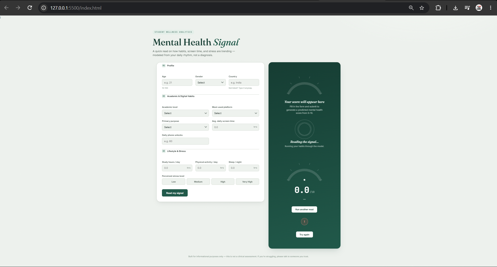

# Mental Health Score Predictor

## Overview
The Mental Health Score Predictor is a machine learning project that predicts a mental health score based on input data. The project includes a web interface that allows users to enter information and view a prediction.

## Features
- Predicts a mental health score using a trained machine learning model.
- Provides a simple web interface for user interaction.
- Uses Python for the prediction backend.
- Includes a trained model saved as a `.pkl` file.

## Technologies Used
- Python
- Machine Learning
- HTML
- CSS
- JavaScript
- FastAPI or the backend framework used in this project

## Project Files
- `main.py` — Python application and prediction logic.
- `Mental_Health_Model.pkl` — Trained machine learning model.
- `index.html` — Web interface.
- `style.css` — Interface styling.
- `script.js` — Frontend interactions.
- `requirements.txt` — Python dependencies.
- `README.md` — Project documentation.

## How to Run
1. Clone or download this repository.
2. Install Python and the required dependencies.
3. Install the dependencies using `pip install -r requirements.txt`.
4. Start the application using the command appropriate for the backend framework.
5. Open the application in your browser as instructed by the backend.

## Application Screenshot

## Disclaimer
This project is intended for educational purposes only. It is not a substitute for professional mental health assessment or medical advice.
